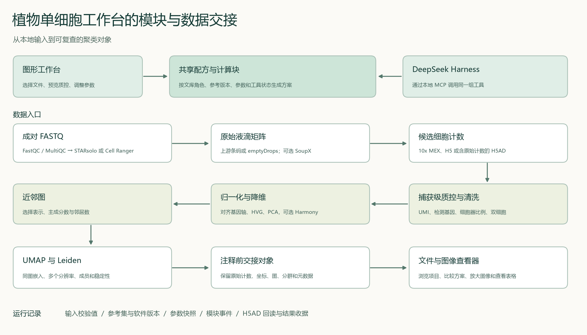

# 植物单细胞工作台 · 设计总案与开发方案

2026-11-18。科研终点是可由下一位分析者直接接手的带分区计数对象。参考范围、工作流、计算块和版本管理均围绕这一交付物设计。

## 学术与工程议会的决策记录

本轮为 AI 辅助设计与工程评审。植物单细胞方法席实现和检验计数语义、逐捕获质控、双细胞与图分区。植物参考和上游席核对组装版本、下载离线基因集、准备外部工具。科研交互工程席开发本地数据接入、固定分析工作位和结果浏览。现行五个工作位各自提供所需的数据入口，详见电子实验记录 PSW-006。集成负责人复审接口、组装作业、修复跨模块问题，并在真实界面及 DSH 宿主中验证。人类科学家尚未签署生物学有效性评审。

| 议题 | 决策与实现 |
|---|---|
| 上传与元数据 | 直接引用本地文件，自动识别文件角色。表格批量导入可选；只需补足无法从表达矩阵判断的模态、物种、样本事实。无条件比较的项目可留空处理与批次。 |
| 参考与默认值 | 预装三种明确版本的植物线粒体和质体基因集。匹配按稳定 ID，返回实测支持；少量或歧义匹配不推荐。用户可覆盖。细胞器比例缺少依据时标为缺失。 |
| FASTQ 定量 | 10x 3′ v3/v3.1。增加可在本机 Linux/WSL 运行的开放 STARsolo 路线，随项目准备拟南芥 TAIR10 release 62 基因组、GTF、索引及 10x v3 白名单。保留独立的 Cell Ranger 10 适配。显式记录实际引擎、参考和内含子选项。 |
| 常规处理 | 逐捕获 MAD 低端提示，默认倍数 4，最小 UMI/基因数默认为 1；线粒体和质体上限留空。Scrublet 默认只报告，初始预期率 0.05 可按上样调整。核与细胞、跨组装、跨物种须分开考虑。 |
| 建图与稳定性 | 默认按 1 万归一化并 log1p、Seurat 离散度 2,000 个 HVG、30 PC、15 邻居、分辨率 0.5 和 1.0、种子 42。另提供基于整数 UMI 的 Seurat v3 模式；默认使用免拟合局部曲线的离散度方案，原始整数层一直保留。可用基因/细胞少时明确记录实际维度。 |
| 整合与环境 RNA | 都是可选分支。有匹配背景才启用 SoupX；可自动建立临时粗分群或使用研究者提供的分组。校正层和原始计数分别保留。Harmony 检查批次与条件支持，保存邻域和混合诊断。 |
| 交互与复现 | 工作位对应可复用计算模块。用户可以一键执行、预览、复用父图、更换分辨率、保存或交换配方。程序化工具与工作台调用同一个本地服务和执行器。 |

## 组件和数据怎样交接

| 计算块 | 输入与算法 | 输出、跳转或重用方式 |
|---|---|---|
| 读取与角色发现 | 路径、样本表、MEX/H5/H5AD 或 FASTQ；检查条码、特征轴、稳定 ID 与计数层 | 文库清单、参考候选和待核对项 |
| 测序质检 | 捕获内成对读段；FastQC、MultiQC | 分文件报告与汇总，能独立运行 |
| 索引和定量 | STARsolo 或 Cell Ranger，FASTA/GTF、索引、配对文件、化学版本、UMI、是否纳入内含子 | raw/filtered 计数自动进入同一流水线；单独定量可导出存档 |
| 条码调用 | 优先继承上游选定细胞；仅 raw 或用户要求重新判定时用 emptyDrops | 完整条码 FDR 和保留表、候选计数 |
| 去污染 | 同一捕获 raw + filtered、临时分群；SoupX | 污染估计和校正矩阵，统计层与原始 UMI 明确区分 |
| 捕获 QC | 每个细胞/核的 UMI、基因数、器官基因集比例；MAD 与 Scrublet | 排除规则、重叠数、去留、逐文库覆盖。预览跳过双细胞，界面明确提示 |
| 对齐与合并 | 一致基因集优先；按用户选择取交集 | 合并对象、文库身份、损失的计数和基因数量 |
| 特征与表示 | 按选定层归一化和选择 HVG；PCA，可选 Harmony | 全部可用基因、HVG 掩码、PC 表及与原始表示的诊断 |
| 邻居图 | 选择 PC/整合表示、K 与种子 | H5AD 的 connectivities、distances；用于分区和 UMAP |
| UMAP、Leiden 和比较 | 同一邻居图分别生成坐标和分区；跨分辨率及备用种子比较 | 簇成员交叉表、Jaccard、ARI 和样本构成。同一父图可另起任务重分区 |
| 交接与复现 | 所有选定对象、参数、模块事件和软件版本 | H5AD 回读、全量细胞表、图、表、收据、运行配置及实现代码 |

计算块定义在 `backend/blocks.py`，包括适用动作、引擎、输入、输出和参数字段。程序根据文件角色和用户设置生成具体配方；调用原生科学函数时记录开始、完成、失败和耗时。中间矩阵留在本地进程或运行目录。项目 SQLite 保存文件引用和作业状态。不同任务使用独立目录，已有运行收据和图可被后续任务引用。

工作台包含六个固定工作位。中心是当前参数和结果，侧栏给出当前项目、文库、参考以及最近一次任务。选择结果可查看 UMAP、按分区/样本/捕获着色并查询成员；大图绘制抽样，成员计数按全量计算。文件管理器提供当前项目及已登记输入目录的视图。输入只读，图和表按同一版本出现在结果目录。

## 工作位之间可重用的三种结果

| 研究者操作 | 计算起点 | 可验证的交接 |
|---|---|---|
| 运行完整分析 | 当前文库及参考 | 输入角色决定是否定量、调用液滴、校正污染；后续处理一次贯通 |
| 执行清洗并保存对象，然后继续降维 | 新建清洗任务，再选择本项目成功的质控来源 | qc.h5ad 的细胞轴、全基因计数、捕获标记、逐条码表、摘要和回执一并保存；继续任务先核对对象指纹 |
| 比较当前分辨率 | 选择已有分析或分群任务 | 只重算图分区，保留原图与坐标，按条码比较成员与稳定性 |

图形界面与 MCP 共用 analysis、quality、from_qc、recluster、read_qc、quantify、build_reference 七种操作。同一任务的每一步记录在 block-events.jsonl；可按事件检查实际执行顺序及失败信息。

## 开发、发布与验收

| 次序 | 工程交付 | 检验条件 |
|---|---|---|
| 1 | 建立独立源码、环境、实验簿与参考注册表 | 离线读取内置集合，核对 GFF 来源和指纹；错误版本可改为自定义 |
| 2 | 矩阵入口及科学计算块 | 拟南芥真实 scRNA、snRNA 分别通过，导出并回读 H5AD；单测验证错误计数与基因轴 |
| 3 | 测序端和原始液滴端 | FASTQ 按识别出来的文件自动进入定量，保留实际运行日志；分别验证 R 和 Linux 阶段，记录可用环境 |
| 4 | 无代码界面及文件查看 | 浏览器实际提交任务、查看过滤预览、换图、缩放和读表；桌面与窄屏分别核验 |
| 5 | 参数配方和宿主适配 | 相同父图、种子和分辨率，经 GUI 与真实 DSH 工具服务得到相同分区；两个入口均能查回执 |
| 后续科学验证 | 新研究、罕见群体及物种/组织外推 | 独立研究需在调参之前隔离；有正交真值再评价双细胞/污染准确性；以研究者实际任务测试体验 |

开发与质控依据：[植物单细胞与单核指南](https://doi.org/10.1093/plcell/koae003)、[Scanpy 官方教程](https://scanpy.readthedocs.io/en/latest/tutorials/basics/clustering.html)、[STARsolo 作者文档](https://github.com/alexdobin/STAR/blob/2.7.11b/docs/STARsolo.md)、[Cell Ranger 官方文档](https://www.10xgenomics.com/support/software/cell-ranger/latest/tutorials/cr-tutorial-ct)、[DropletUtils](https://bioconductor.org/packages/release/bioc/html/DropletUtils.html)、[SoupX](https://github.com/constantAmateur/SoupX)、[Scrublet](https://github.com/swolock/scrublet)、[DSH](https://github.com/deepseek-ai/deepseek-harness)。

