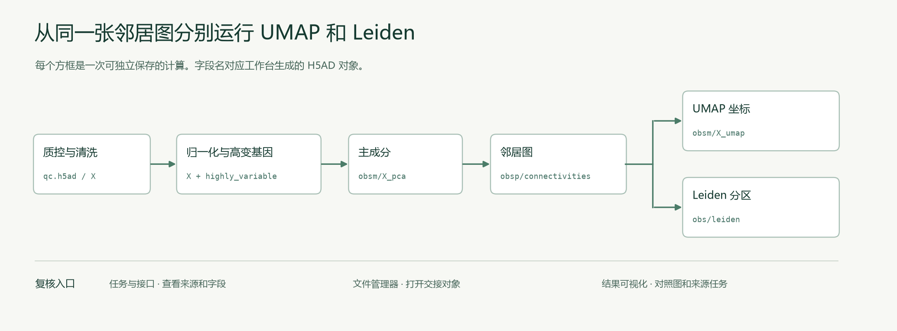

# 植物单细胞工作台的任务、文件与图形

## 从科研问题选择运行粒度

| 研究者要做的事 | 在工作台中的操作 | 新作业的结果 |
|---|---|---|
| 第一次处理一个样本或一组兼容的捕获 | 在测序或质控工作位选择文件或上传，核对捕获、模态、组装，按当前配方运行 | 带原始层、表示、图和分区的分析对象 |
| 先判断细胞保留是否合理 | 质控与清洗 → 执行清洗并保存对象 | 逐捕获 QC 表、筛除原因和 qc.h5ad |
| 只改变近邻数或批次处理 | 降维或聚类工作位选择原 PCA、特征任务或有相应字段的外部 H5AD | 新的邻居图或 PCA，保留来源任务 ID |
| 用同一张图比较参数 | 分别从该图运行 UMAP 和 Leiden；有完整父对象时也可使用“复用已有邻居图” | 两个分支拥有独立目录，能排除其他计算步骤变化带来的差异 |
| 查看或交付数据 | 文件管理器定位对象，结果可视化按任务查看图。在“任务与接口”下载清单 | 完整坐标、分区表、可用的 PNG/SVG 以及机器可读清单 |

各工作位独立保存输入选择。“本步文件”显示使用的来源、运行目录以及可打开的图表和数据文件。原位引用保留本机路径，浏览器上传按批次存放在本项目的 imports 目录。

三类输入分别适合成对 10x 3′ FASTQ、含背景液滴的原始计数、已调用条码的矩阵。归一化数据进入质控需要指定并验证其整数计数层。独立参考构建和测序质检也可单独运行。不同组织、条件、批次与生物重复应在文库表中登记；同一捕获的多个 lane 作为同一个捕获处理。

## 各工作位可以从哪里开始

| 工作位或模块 | 可直接使用的文件 | 也可复用的项目结果 |
|---|---|---|
| 测序与定量 | 同一捕获成对的 R1/R2，按 lane 匹配 | 本机已有的定量索引 |
| 质控与清洗 | 10x MEX、GEX H5、带原始计数的 H5AD、文库表 | 按捕获取已完成定量任务中的 raw/filtered |
| 特征选择 | 已清洗的非负整数 UMI，取 layers/counts 或 X | 质控对象或含可验证计数层的模块结果 |
| PCA | 对数表达 X 与布尔 var/highly_variable | 特征选择结果 |
| 邻居图 | obsm/X_pca 或 obsm/X_pca_harmony | PCA 表示 |
| UMAP | 标准 Scanpy 近邻图，含权重、距离及 neighbors 参数 | 邻居图结果 |
| Leiden | obsp/connectivities 中的细胞连通权重 | 同一张邻居图，可独立于 UMAP 运行 |

单模块的 Harness 配方可传入 `external_h5ad` 本机绝对路径，也可用 `parent_job` 指定来源任务。两项择一使用。执行收据同时记录文件路径、SHA-256 和实际读取的 H5AD 字段。Harmony 需要 obs 中可核对的 batch 和 condition。已有对象做聚类时，缺少样本标签的细胞在样本构成表中标记为“未登记”。

## 数据接口

13 个计算模块各自公布输入和输出的数据类型、必需性、参数、使用条件及方法来源。12 种可提交的任务涵盖完整分析、独立质控、从质控继续、复用图重聚类、测序质检、定量、参考构建，以及特征、PCA、邻居图、UMAP 和 Leiden 五项单模块运行。条码判定、去污染和文库合并按输入条件在配方中执行。所有计算的质量检查与运行归档都使用同一个执行入口。

| 阶段 | 科研人员需要确认的输入 | 可复核的输出 |
|---|---|---|
| 测序质检、索引、定量 | 实际 FASTQ 配对、白名单、化学体系、同版 FASTA/GTF 或索引 | FastQC/MultiQC、各捕获 raw/filtered、索引及输入指纹 |
| 条码判定、环境 RNA | 对应物理捕获的背景、候选计数和粗分群 | 条码 FDR、校正矩阵、估计污染率，保留原始整数层 |
| QC 与文库合并 | 独立捕获、物种参考、基因轴与拼接方式 | 逐条码指标和保留决定、合并后损失记录、对齐计数 |
| 特征、PCA、近邻图 | 可复用计数、特征掩码、实际用于建图的表示 | 对数表达、HVG 掩码、原始或校正 PCA、距离与连通权重 |
| UMAP、Leiden、导出 | 同一张邻居图、随机种子、分辨率 | UMAP 坐标、不同分辨率的成员、ARI 和簇间重叠、文件清单 |

运行前可在“查看执行模块”展开方法依据。完成后打开“任务与接口 → 输入与输出”。清单绑定实际路径，H5AD 内部产物带字段，例如图模块输出的 `obsp/connectivities`；外部应用可用相同选择器读取。父任务交接对象的校验值、当前参数、输入文件 SHA-256、模块日志、代码快照和输出收据随结果保存。旧版作业按原始收据展示。运行中或失败时显示已登记输入及已落盘的部分产物。

DeepSeek Harness 通过 `catalog` 发现接口，通过 `plan` 核对输入，通过 `run` 提交异步任务。已有图任务的 ID 可以分别传给 `action=umap` 和 `action=leiden` 的 `parent_job`。使用 `status` 查询状态，使用 `task_io` 定位实际图、计数、坐标或分区。可指定 `module`、`capture`，或用 `include_inventory=true` 取逐文件清单。网页和 Harness 共享同一套输入验证与计算函数。

## 分区工作区与独立页面

在任一分析步骤的“项目工作区”，可同时查看文件或表格和另一项图表。用“上游输出”指定本步用途、来源任务及相应产物，然后点击“用作本步输入”。在项目目录和预览页签中，对当前用途兼容的归档对象也可直接选用。质控接入定量结果时按捕获关联 raw/filtered 和原样本信息。特征计算、PCA、建图、UMAP 和 Leiden 使用对应上游对象的父任务 ID。选择后可继续调整参数，点击运行才会提交任务。

需要更宽的对照区域时，可以在步骤内点“展开工作区”，也可以在侧边栏打开“分区工作区”。左侧在“文件”和“预览”之间切换，右侧在“图表”和“任务”之间切换。例如，可在左侧打开某次运行的 QC 表，右侧保留同一运行的 UMAP。点击“查看源目录”定位对应文件夹，拖动分隔条调整宽度，或用“放大”单独查看一侧。窄屏自动上下排列。[五个科研测试项目及分区截图](../lab-notebook/005-分区工作区与五项目验收.md)

文件管理器提供项目目录树、已登记输入目录、路径导航、排序筛选、图片缩略图、表格预览、本机资源管理器、新建文件夹和复制操作。运行归档和输入来源在工作台内只读；研究者可将结果复制到项目交付目录。结果可视化由所选任务的实际输出生成图表清单，支持 UMAP 着色、源坐标下载及可用图的矢量导出。单独运行 Leiden 时，可在此直接查看分区间 ARI。两个页面都能以地址直接打开、刷新和返回。这一交互借鉴了 RStudio 的 Files、Plots 分工。[Posit 官方界面指南](https://docs.posit.co/ide/user/ide/guide/ui/ui-panes.html)

## 如何判断方法是否适用

| 决策点 | 当前默认或条件 | 研究者审核的证据 |
|---|---|---|
| 质体、线粒体与双细胞 | 逐捕获 QC；细胞器比例可由研究者指定上限；双细胞默认评分报告 | 按 scRNA/snRNA、组织、参考覆盖和每个捕获的分布，检查被筛除群体 |
| 是否去污染 | SoupX 需同一捕获的背景液滴、候选计数和可用分组。可同时保留原始层和校正层 | 污染率、原始与校正表达的差异，特别检查组织特异高表达基因 |
| 是否整合批次 | 保留普通 PCA；申请 Harmony 时检查批次与条件交叉支持、细胞数及校正表示 | 校正前后批次混合、条件一致性、邻域保留率 |
| 如何定分群粒度 | 同一图上比较多个分辨率并改变一次种子 | ARI、分区重叠、每个簇的样本构成；再结合研究问题判断 |
| 如何泛化 | 同参数检查全流程与独立模块的数值等价，跨项目并发测试隔离 | 现有材料以公开拟南芥数据和合成夹具为主。新品种、组织及稀有群保留需独立数据验证 |

依据包括植物领域报告规范、Scanpy 公开预处理流程，以及各专用算法的适用条件。科研结论需要组织和实验设计提供独立支持。[植物单细胞与单核最佳实践](https://doi.org/10.1093/plcell/koae003) · [Scanpy 预处理与聚类](https://scanpy.readthedocs.io/en/stable/tutorials/basics/clustering.html) · [emptyDrops](https://doi.org/10.1186/s13059-019-1662-y) · [SoupX](https://doi.org/10.1093/gigascience/giaa151)

## 多任务与复现

本机服务使用先进先出队列，每个作业有独立进程、参数、目录和日志。默认并发 2；服务启动时可用 `Start-Workbench.ps1 -MaxJobs 1` 为大型作业单独留出机器。每个外部工具的线程、内存参数与全机并发槽位分别管理。当前没有操作系统级逐作业内存配额，重启后原先未完成的作业会列为中断，可用保存的方案重新提交。详细验证材料见[本轮电子实验记录](../lab-notebook/004-模块接口与多任务验收.md)。

